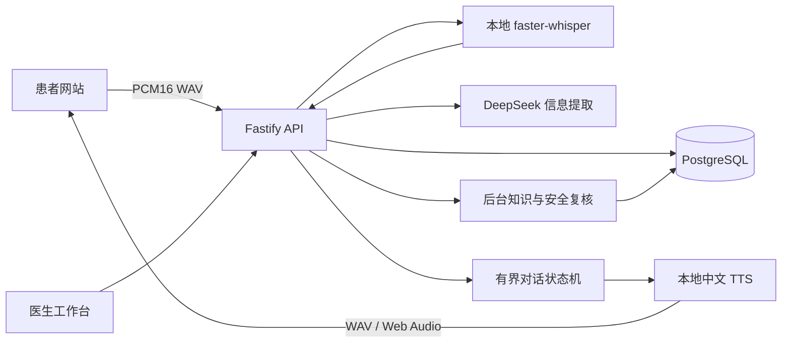

# 心伴随访 · Heart Follow-up

面向患者的中文语音随访网站，以及独立登录的医生工作台。当前以心衰出院随访为研究场景：患者听问题、用语音回答，完成后查看简短采集小结；医生维护档案、安排随访、审核记录并发布反馈。

患者随访不提供文字聊天输入框。账号、密码和联系信息表单仍使用常规输入。

> 这是医工交叉研究与工程实现，尚未经过临床有效性验证。采集协议需要合作医生审核；软件不提供自动诊断、处方、用药调整或真实电话外呼，也不能代替急救。请使用合成资料进行开发与测试。

## 功能与结构

- 患者端 `/patient/`：独立账号、首次改密、健康档案、随访安排、语音通话、历史小结和医生反馈。
- 医生端 `/doctor/`：患者建档、开通/重置患者账号、病历维护、随访日程、小结审核与反馈发布。
- 语音流程：Web Audio / AudioWorklet 录音，静音断句，服务器 ASR 转写，结构化采集，中文 TTS 播报；支持打断、重播、暂停、恢复和结束保存。
- 数据与权限：PostgreSQL、分角色会话、CSRF 校验、医生与患者的数据归属检查、幂等上传、版本检查与后台任务。



Agent 部分是自定义 TypeScript 编排，包含采集、协议/安全检查与后台复核；实时轮次只运行一次信息提取，再选择下一问。当前没有使用 LangChain、LangGraph 或向量 RAG，也不向患者展示内部推理链。没有测量、不确定、拒答和未采集分别保留，不推断为正常。

| 目录 | 内容 |
|---|---|
| `apps/api` | Fastify、鉴权、数据接口、Agent 编排、语音路由 |
| `apps/patient-web` | Vue 3 患者网站、录音、语音播放与通话状态机 |
| `apps/clinician-web` | Vue 3 / Element Plus 医生工作台 |
| `packages/contracts` | 共用校验与接口契约 |
| `database/migrations` | PostgreSQL 迁移 |
| `speech` | 本地 ASR / TTS 服务、依赖与模型来源 |
| `deploy` | 通用 Nginx 与 systemd 示例 |

## 本地启动

需要 Node.js **24.x**、npm、Docker Compose（或自行安装 PostgreSQL 16）。语音服务另需 Python 3.10+，建议在 Linux 上运行。

```bash
git clone https://github.com/lzywzh/heart-followup-web.git
cd heart-followup-web
npm ci
node scripts/init-dev-env.mjs
docker compose up -d --wait postgres
npm run setup:local
npm run build
npm run dev
```

`init-dev-env.mjs` 生成仅本机使用的随机数据库密码和会话密钥，已存在 `.env` 时拒绝覆盖。Compose 只启动开发数据库，5432 端口仅绑定本机，并创建独立的 `_test` 数据库。已有 PostgreSQL 时可跳过 Compose，按 `.env.example` 配置数据库连接。

启动后访问：

| 入口 | 地址 |
|---|---|
| 医生 | `http://127.0.0.1:5173/doctor/` |
| 患者 | `http://127.0.0.1:5174/patient/` |
| API 与构建后的两端 | `http://127.0.0.1:3200` |

`setup:local` 迁移数据库，并创建本地医生/管理员账号；随机初始密码保存在被 Git 忽略的 `.runtime/account-*.json`。没有通用默认密码。医生账号默认名称为 `doctor`，管理员用于初始化；日常随访请使用医生账号。首次初始化不创建患者或病历。

默认 `COLLECTION_MODE=scripted` 只用于本地流程联调。启用 AI 信息提取时，在本机 `.env` 设置 `COLLECTION_MODE=ai` 与自己的 `DEEPSEEK_API_KEY`。真实语音还需按[语音服务说明](docs/setup/voice.md)启动 ASR 和 TTS；仅启动网页不会自动具备语音能力。

## 开始一次随访

1. 医生登录，核对采集协议，使用合成资料建档，开通患者账号并安排随访。
2. 患者用独立账号登录并完成首次改密，在任务开放后进入语音随访。
3. 点击开始、允许麦克风，听完问题后直接回答；完成后点击结束，等待小结保存。
4. 医生在工作台查看同一份采集小结，审核后发布反馈。

生产环境拒绝开发鉴权与 scripted 采集，未审核的采集协议不能直接启用。临床协议草案见 [clinical-protocol.md](docs/design/clinical-protocol.md)。

## 语音与浏览器

默认 `VOICE_TTS_MODE=server`：在同一服务器运行 sherpa-onnx / Matcha 中文合成，返回标准 WAV。点击开始时解锁 Web Audio，播放不要求浏览器提供 SpeechSynthesis。`browser` 模式依赖设备中文声音；`cloud` 模式需要另行配置云语音服务。

麦克风需要受信任的 HTTPS 或本机 localhost，以及设备支持 AudioWorklet。手机访问开发电脑的普通 HTTP 局域网地址不能代替 HTTPS。微信、iOS/Android 的麦克风、自动播放和后台暂停仍需实机验证，不承诺所有版本兼容。

ASR/TTS 只监听服务器回环端口。原始录音不写入患者音频文件，数据库保存转写和采集证据。对话模型会收到请求中需要的采集内容；接入外部模型前应确认使用的数据范围和服务约定。本地语音不会产生新的云语音调用费，服务器、模型 API 和可选云语音仍可能计费。

## 测试

先配置以 `_test` 结尾的专用 `TEST_DATABASE_URL`，测试会创建并清理隔离 schema：

```bash
npm test
npm run build
python -m unittest discover -s speech -p 'test_*.py' -v
```

语音浏览器闭环使用真实 Web Audio 解码与录音流程，麦克风输入、合成音频、识别和模型边界使用固定测试数据。需要安装 Google Chrome：

```bash
npx playwright install chrome
npm run test:ui
```

验证缺少浏览器朗读接口时的服务器播报：

```powershell
$env:ACCEPTANCE_TTS_MODE='server'
npm run test:ui
```

Linux/macOS 可使用 `ACCEPTANCE_TTS_MODE=server npm run test:ui`。软件测试不代替真人手机和临床验证。

## 部署与许可证

部署指南见 [deployment.md](docs/setup/deployment.md)。通用配置以 `followup.example.com` 为占位域名，需要自行配置 HTTPS、服务用户、独立数据库权限和凭据。仓库包含源码、数据库结构和合成测试，不包含实际患者资料、可用账号密码、运行环境文件、模型权重或线上服务器配置。

项目原创代码按 [MIT](LICENSE) 开源。第三方组件与模型保留各自许可证，见 [THIRD_PARTY_NOTICES.md](THIRD_PARTY_NOTICES.md) 和 [speech/MODEL_NOTICE.md](speech/MODEL_NOTICE.md)。
